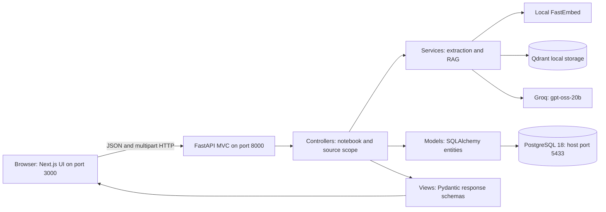
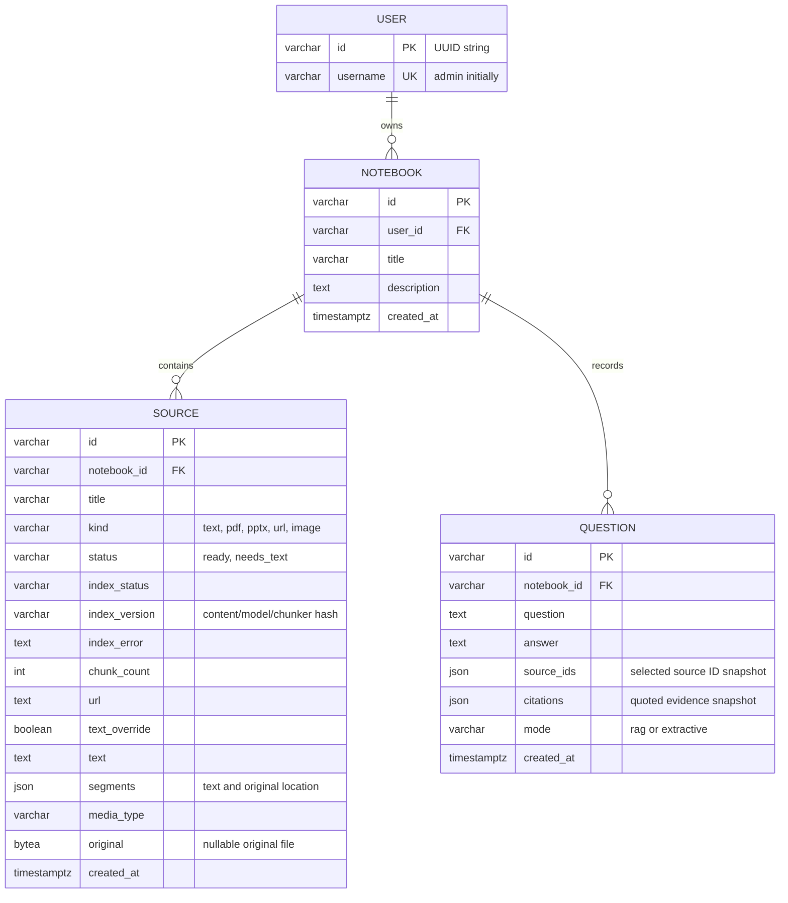

# Current architecture

This document describes the implemented MVP. The [original long-term plan](roadmap-architecture.md) is retained separately. The MVP uses two host processes and a PostgreSQL 18 container. It has one seeded admin user, no authentication, and Groq for answer generation. The AI Python package runs inside FastAPI.

## Entity relationship diagram

A user owns many notebooks and a notebook owns many sources and question/answer pairs. A source belongs to exactly one notebook. IDs are UUID strings; PostgreSQL foreign keys enforce ownership links. Deleting a notebook cascades to its sources and questions. Migration `294f77dd9659` creates the schema and seeds a single `admin` row, id `00000000-0000-0000-0000-000000000001`.

Question source IDs and citations are **historical JSON snapshots**, not foreign-key relationships. A citation stores the source ID, title, page/paragraph location, and excerpt. Deleting a source preserves past quoted evidence; opening its original returns 404. Deleting the notebook removes those snapshots too. This is intentional history behavior, not a normalized many-to-many join.

## MVC mapping

- **Model:** `backend/src/notebook_backend/models/entities.py` owns SQLAlchemy persistence entities and relationships.
- **View:** `backend/src/notebook_backend/views/schemas.py` defines validated input/output representations. Next.js provides the human-facing view.
- **Controller:** `backend/src/notebook_backend/controllers/notebooks.py` handles HTTP requests, current-admin scope, notebook/source ownership, and transactions.
- **Services:** parsing and answer retrieval live outside controllers in `services/`, making those algorithms independently replaceable.

The frontend communicates directly with the backend over HTTP. The browser never connects to PostgreSQL. CORS permits `http://localhost:3000` by default. Use the same hostname consistently; `127.0.0.1:3000` is a different origin and needs an explicit CORS entry if used.

## Source and question flow

1. Create a notebook in PostgreSQL.
2. Add text or upload a file (10 MB limit). Parsing runs synchronously in a FastAPI worker thread. PDFs are limited to 100 pages and all extracted text to 200,000 characters.
3. Store validated original bytes and extracted segments in the same database transaction. This avoids filesystem/database orphan handling for the small local MVP. Original file bytes are deferred by the ORM and not loaded by list queries.
4. Select one or more ready sources. The backend rejects missing, foreign, or untranscribed sources.
5. Embed the question, retrieve scoped dense and BM25 candidates, fuse ranks, and select diverse evidence. Groq generates structured claims; validate their citation IDs against retrieved evidence before rendering numbered citations.
6. Save the question, answer, source-selection snapshot, and evidence snapshots in PostgreSQL. Refreshing the UI restores history. History is not currently supplied as conversational context to Groq.

## Operational scope

PostgreSQL is authoritative; Qdrant is a rebuildable derived index. Uploads commit source data and then index synchronously. Source versions and notebook row locks protect index publication. Failed indexing remains visible and retryable. Local Qdrant requires one backend process; a remote Qdrant URL is optional. No separate AI service or application container is needed.

No authentication, OCR, background queue, generated reports, or quizzes are implemented. Parsers have file/page/text bounds but are not isolated workers. Larger workloads need background jobs, object storage and scalable lexical indexing. See [the implemented AI pipeline](vector-indexing.md) for configuration, API and limitations.
