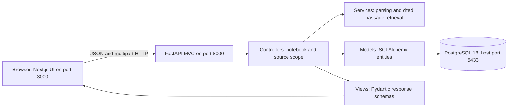
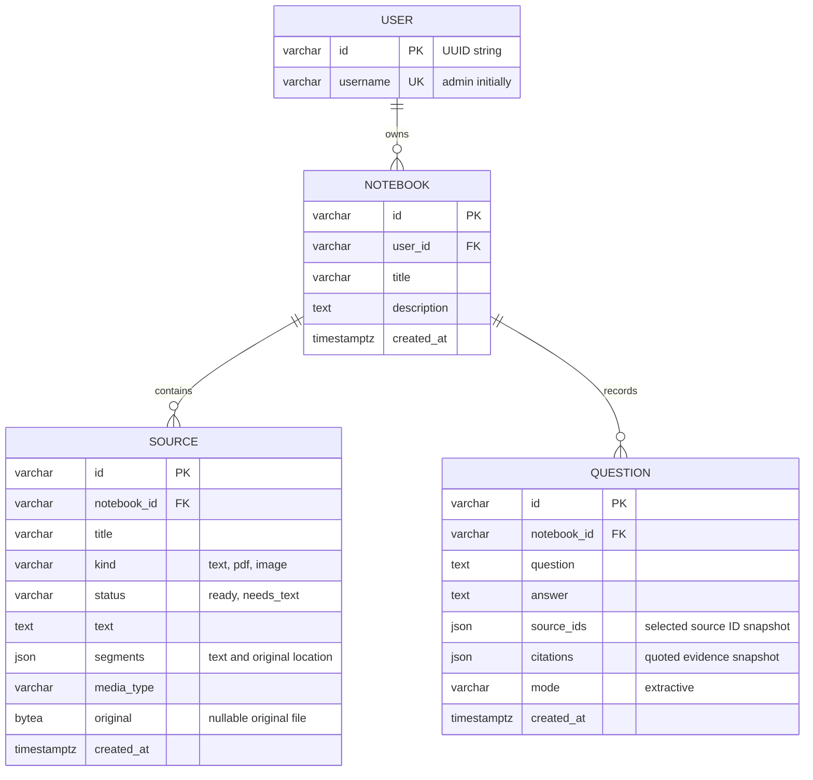

# Current architecture

This document describes the implemented MVP. The [original long-term plan](roadmap-architecture.md) is retained separately. The MVP uses two host processes and a PostgreSQL 18 container. It has one seeded admin user, no authentication, and no external model service.

## Entity relationship diagram

A user owns many notebooks and a notebook owns many sources and question/answer pairs. A source belongs to exactly one notebook. IDs are UUID strings; PostgreSQL foreign keys enforce ownership links. Deleting a notebook cascades to its sources and questions. Migration `294f77dd9659` creates the schema and seeds a single `admin` row, id `00000000-0000-0000-0000-000000000001`.

Question source IDs and citations are **historical JSON snapshots**, not foreign-key relationships. A citation stores the source ID, title, page/paragraph location, and excerpt. Deleting a source preserves past quoted evidence; opening its original returns 404. Deleting the notebook removes those snapshots too. This is intentional history behavior, not a normalized many-to-many join.

## MVC mapping

- **Model:** `backend/src/notebook_backend/models/entities.py` owns SQLAlchemy persistence entities and relationships.
- **View:** `backend/src/notebook_backend/views/schemas.py` defines validated input/output representations. Next.js provides the human-facing view.
- **Controller:** `backend/src/notebook_backend/controllers/notebooks.py` handles HTTP requests, current-admin scope, notebook/source ownership, and transactions.
- **Services:** parsing and answer retrieval live outside controllers in `services/`, making those algorithms independently replaceable.

The frontend communicates directly with the backend over HTTP. The browser never connects to PostgreSQL. CORS permits `http://localhost:3000` by default. Use the same hostname consistently; `127.0.0.1:3000` is a different origin and needs an explicit CORS entry if used.

## Source and question flow

1. Create a notebook in PostgreSQL.
2. Add text or upload a file (10 MB limit). Parsing runs synchronously in a FastAPI worker thread. PDFs are limited to 100 pages and all extracted text to 200,000 characters.
3. Store validated original bytes and extracted segments in the same database transaction. This avoids filesystem/database orphan handling for the small local MVP. Original file bytes are deferred by the ORM and not loaded by list queries.
4. Select one or more ready sources. The backend rejects missing, foreign, or untranscribed sources.
5. Tokenize the question, rank matching segments by inverse document frequency, and return up to three quoted passages. Every passage carries its source and location. If no words match, return an explicit no-match answer.
6. Save the question, answer, source-selection snapshot, and evidence snapshots in PostgreSQL. Refreshing the UI restores history.

This is lexical retrieval only: it cannot understand paraphrases, synthesize an answer, interpret images, or reliably judge whether a passage answers the question. The UI explicitly calls it “Cited passages” and describes local passage search. Add a configurable generative provider later, keeping the same source-scope and citation contracts.

## Deliberate scope

No application containers, authentication, AI microservice, vector database, cloud storage, background queue, URL ingestion, PPTX parsing, OCR, generated reports, or quizzes in this milestone. PDF parsing is bounded by file/page/text limits but is not sandboxed or time-limited; public deployment requires a hardened ingestion worker. File bytes in PostgreSQL and synchronous parsing suit small local notebooks; larger workloads need object storage and jobs. Lists currently load a complete notebook/library and will need pagination at larger scale.

## Next: semantic retrieval

See [the vector-indexing design](vector-indexing.md) for the planned `index_source(source_id)` job, source-to-vector flow, scoped question retrieval, saved chat context, and retry/version/deletion behavior. It is a design, not an implemented feature.
