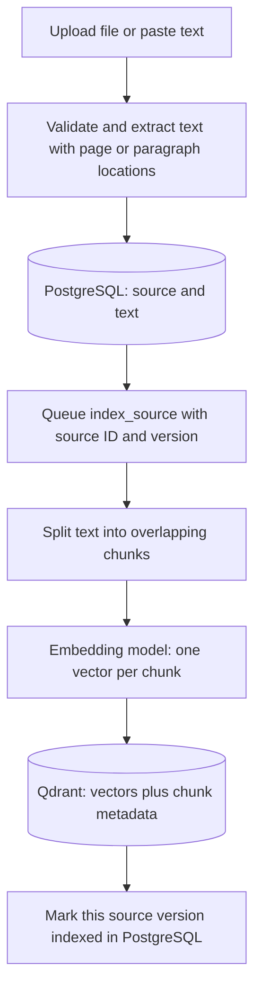
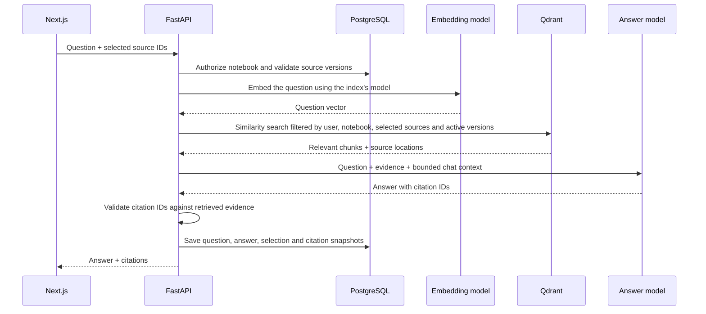

# From sources to a vector index

**Design for the next AI milestone; not implemented yet.** The working MVP stores sources and question history in PostgreSQL and retrieves passages by matching words. It does not currently call an embedding model, create vectors, or run Qdrant.

## Two separate kinds of persistence

- **Source persistence:** PostgreSQL owns users, notebooks, sources, original bytes, extracted text, and locations. An optional vector store is a derived search index over source text.
- **Chat persistence:** the `questions` table stores each question/answer pair, selected-source IDs, and citation snapshots. This restores the conversation on refresh. Saved history alone does not make a model remember: the future answer service must explicitly include a bounded set of previous turns, or their summary, in each model request.

Google documents automatically saved, deletable chat history that is private to the person chatting even in shared notebooks: [Google's NotebookLM announcement](https://blog.google/innovation-and-ai/models-and-research/google-labs/notebooklm-custom-personas-engine-upgrade/). This describes product behavior, not Google's internal database design. Our storage design is our own.

## Ingestion: an `index_source(source_id)` job

Yes: a function/job that reads saved source text and converts chunks into vectors is the right boundary. Run it for new/changed sources, not for the entire database every time someone asks a question.



A PDF file is not embedded as raw database bytes. First extract text; scanned PDFs and images need OCR or a suitable multimodal path. The current app lets you supply a transcription. Chunk the extracted text without losing page references, then pass each chunk to an embedding model, which produces a numeric vector representing its content.

Store each vector with metadata such as:

```json
{
  "source_id": "source-uuid",
  "notebook_id": "notebook-uuid",
  "user_id": "admin-uuid",
  "source_version": 1,
  "chunk_index": 0,
  "location": "Page 3",
  "text": "The original passage...",
  "embedding_model": "chosen-model-and-version"
}
```

Qdrant stores a point as a vector plus optional payload; payload fields support scoped filtering. See [Qdrant points](https://qdrant.tech/documentation/manage-data/points/) and [filtering](https://qdrant.tech/documentation/search/filtering/). The original architecture planned Qdrant. An alternative is PostgreSQL with the pgvector extension, but that is a separate database/image decision; the current stock PostgreSQL 18 container does not include that extension.

The intended service shape is approximately:

```python
# Pseudocode — these adapters and version fields do not exist in the MVP yet.
def index_source(source_id, expected_version):
    source = source_repository.read(source_id)
    assert source.version == expected_version
    chunks = chunk_text(source.text, preserve_locations=True)
    vectors = embeddings.embed_documents([chunk.text for chunk in chunks])
    points = make_points(source, chunks, vectors)  # deterministic versioned IDs
    vector_store.upsert(points)
    # Publish readiness only if this source still exists at the same version.
    source_repository.mark_indexed_if_current(source.id, expected_version)
```

Before implementing it, add `source_version`, text/content hash, indexing state (`pending`, `processing`, `ready`, `failed`), model version, and durable job records. Parsing readiness and indexing readiness should be separate; the current `ready` flag only means source text is available for lexical search.

## Question answering: retrieve first, then generate



Use the same compatible embedding model and vector dimension for documents and questions. The answer model receives the retrieved **text**, not the numeric vectors. Embeddings make semantic search possible; they do not by themselves generate answers or train the answer model on uploaded documents.

Do not embed all chat messages as source evidence by default. Generated answers are not authoritative documents. Use recent messages as conversational context; introduce a separate memory index only if a later use case needs it. For multiple conversations per notebook, evolve question/answer pairs into `Conversation` and `Message` entities with user ownership.

## Reliability rules for implementation

1. Trigger ingestion after the source transaction commits, preferably through a durable job/outbox written with that transaction. A database polling worker can run on the host; no new application container is required.
2. Use deterministic point IDs derived from source ID, content version, and chunk index, so retries upsert instead of duplicating data.
3. Embed only new or changed text. Retrying an unchanged job should not require repeatedly paying for identical embeddings; cache by content hash plus model version.
4. Query only authorized, current, ready source versions. Metadata filters are mandatory even with a single admin initially. Create indexes on the fields used for filtering.
5. On edit, build the new version, mark it ready, and retire the old version. Invalidate old versions immediately for new questions; already-saved citation snapshots remain historical evidence.
6. On deletion, revoke source eligibility in PostgreSQL immediately and enqueue vector cleanup. Late ingestion completion must not make a deleted or superseded source searchable again.
7. Keep failures retryable and visible. Rebuild the vector index from saved source text if necessary. Changing embedding models/dimensions requires a new index or collection and reindexing.

A small local development command can call `index_source` directly. For reliable normal uploads, have the endpoint enqueue the job and return a processing state. A separate `reindex_notebook(notebook_id)` command can backfill existing sources and repair the index.
