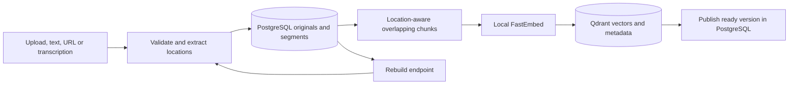

# AI module: ingestion and grounded answers

Implemented in `ai/src/notebook_ai/`, imported by the FastAPI MVC services. PostgreSQL remains the source of truth: originals, extracted segments, indexing state, and question/answer history. Qdrant stores a derived vector index that can be rebuilt without re-uploading files.

## Setup

From `backend/`, install `requirements-dev.lock`, then `pip install --no-deps -e ../ai -e .`, and run `alembic upgrade head`. Configure `backend/.env`:

```dotenv
AI_MODE=rag
GROQ_API_KEY=your-key
GROQ_MODEL=openai/gpt-oss-20b
EMBEDDING_MODEL=BAAI/bge-small-en-v1.5
MODEL_CACHE_PATH=.models
QDRANT_PATH=.qdrant
RAG_TOP_K=6
RAG_MIN_SCORE=0.35
```

Keep the key server-side. Groq generates answers; FastEmbed generates embeddings locally, with no Groq key needed for ingestion. First ingestion downloads the embedding model; subsequent runs use its cache. The default model produces 384-dimensional vectors. Restart the backend after changing configuration. Model changes use a different collection and require reindexing existing sources.

Qdrant runs embedded with persistent local storage: use **one backend process**, not multiple Uvicorn workers. Optionally set `QDRANT_URL` to a separately managed Qdrant server. PostgreSQL 18 remains the only required Docker container. Back up PostgreSQL; the model cache and vector index can be recreated. Do not delete the active local Qdrant directory while the application is running.

`AI_MODE=extractive` explicitly enables the older credential-free quoted-passage mode. It skips indexing and is used for browser tests. Switch back to RAG and rebuild before asking generative questions.

## Ingestion



- PDF: pypdf extraction, page metadata, up to 100 pages. Encrypted or malformed files are rejected. Scanned PDFs need manual transcription; no OCR is claimed.
- PPTX: slide text, grouped shapes, and table cells, with slide metadata. ZIP expansion and slide counts are bounded. Image-only slides need transcription; charts and speaker notes are not extracted.
- TXT/pasted text: UTF-8, paragraph locations, empty/binary rejection.
- URL: one HTTP(S) page, main/article text when available, stored HTML snapshot and source URL. No crawling, browser rendering, login, or JavaScript execution. Public-address checks, DNS-pinned connections and redirect revalidation prevent private-network fetches. Responses are limited to 5 MB. A socket timeout applies, not a total job deadline.
- Existing image uploads remain supported through manual transcription.

File uploads are limited to 10 MB by default and extracted text to 200,000 characters. Extraction preserves page/slide/paragraph boundaries. Within each location, chunks are at most 1,200 characters with up to 200 characters of overlap; the embedding tokenizer further limits them to 400 tokens to avoid silent truncation. Chunk payloads include source ID/title, user/notebook IDs, location, offsets, chunk index, source URL, kind, and a content/model/chunker version hash.

Point IDs are deterministic. Retrying an unchanged complete source can skip embedding; partial indexing retries overwrite points without duplication. Old versions are removed after all new points are written. Queries filter to the current published version. Extraction and indexing readiness are separate: inspect `status`, `index_status`, `index_error`, and `chunk_count`.

Uploads, pasted text, URLs and transcription edits automatically run indexing **before returning**. A successfully saved source may return an indexing failure: its original remains available and the UI offers retry. Requests are synchronous; there is no durable background queue. Interrupted rebuilds can be rerun. Notebook row locks serialize publication, edits, questions and deletion; large ingestion jobs can delay other operations in that notebook.

## Ingestion endpoints

All endpoints use the existing admin ownership scope. These examples assume the backend is on port 8000.

```sh
# Re-extract stored originals and rebuild every admin source.
curl -X POST http://localhost:8000/api/v1/ingestion/rebuild \
  -H 'Content-Type: application/json' \
  -d '{"force":true,"reextract":true}'

# Restrict rebuild to one notebook.
curl -X POST http://localhost:8000/api/v1/ingestion/rebuild \
  -H 'Content-Type: application/json' \
  -d '{"notebook_id":"NOTEBOOK_ID","force":true,"reextract":true}'

# Retry one source, using saved segments and skipping an already complete version.
curl -X POST http://localhost:8000/api/v1/notebooks/NOTEBOOK_ID/sources/SOURCE_ID/ingest \
  -H 'Content-Type: application/json' \
  -d '{"force":false,"reextract":false}'
```

`force` and `reextract` default to true. Rebuild reads PostgreSQL and returns per-source outcomes; inspect failures even on HTTP 200. It preserves explicitly saved transcriptions. URL rebuilds use the stored snapshot, **not** a new network fetch. Rebuild repopulates the active model collection rather than dropping all collections; obsolete model collections may require operator cleanup. Existing source upload remains `POST /api/v1/notebooks/{id}/sources/upload` (multipart `file`); URL creation is `POST /api/v1/notebooks/{id}/sources/url` with `{"url":"https://example.com/page"}`.

## Advanced retrieval and citations

1. Validate selected sources belong to the notebook/user and have a matching ready version. Unindexed selections return 409.
2. Embed the question with the same model as the documents. Retrieve up to 30 dense candidates above the configurable cosine threshold.
3. Compute BM25 over only the selected current source versions and retain up to 30 lexical candidates. This complements semantic retrieval for exact names and identifiers.
4. Fuse rankings using reciprocal rank fusion (constant 60), then apply cosine-based diversity selection and exact text deduplication. Return at most `RAG_TOP_K` passages.
5. Send the question and retrieved evidence to Groq using strict JSON-schema output. Treat document instructions as untrusted evidence. Require citation IDs for each generated claim and permit an explicit insufficient-evidence response.
6. Reject IDs outside retrieved evidence. Render numbered citations from server-owned chunk metadata, never model-generated titles or URLs. Persist answer, selected sources, excerpts, version hashes and chunk IDs in PostgreSQL.

Citation validation guarantees provenance, **not** that every generated claim logically follows from the passage. Users should inspect citations. There is no entailment verifier or cross-encoder reranker. Empty retrieval or model-declared insufficient evidence produces an explicit abstention. Missing credentials/provider failures produce a clear 503 rather than a fabricated answer. Chat history persists for display but is not currently passed as conversational context; ask self-contained questions.

The BM25 implementation scans a bounded local corpus (10,000 selected chunks maximum). This suits small notebooks; larger workloads need server-side lexical indexing. The default embedding model is English-oriented. Extraction quality depends on document structure; there is no OCR or multimodal understanding.

## Verification

From `backend/`: `pytest tests ../ai/tests -q`. Tests use real in-memory Qdrant with deterministic provider doubles, and mocked Groq HTTP responses; they need no model downloads or paid API calls. Coverage includes extraction, URL validation and redirects, overlapping chunks, semantic retrieval, BM25, scope/version isolation, idempotency, deletion, grounded citation validation, failure/retry, PostgreSQL rebuild, and upload-to-question integration. Set `TEST_DATABASE_URL` to run against migrated PostgreSQL 18. A separate manual smoke check verified the real local FastEmbed model and 384-dimensional retrieval.

References: [Groq structured outputs](https://console.groq.com/docs/structured-outputs), [FastEmbed](https://qdrant.github.io/fastembed/Getting%20Started/), [Qdrant filtering](https://qdrant.tech/documentation/search/filtering/).
